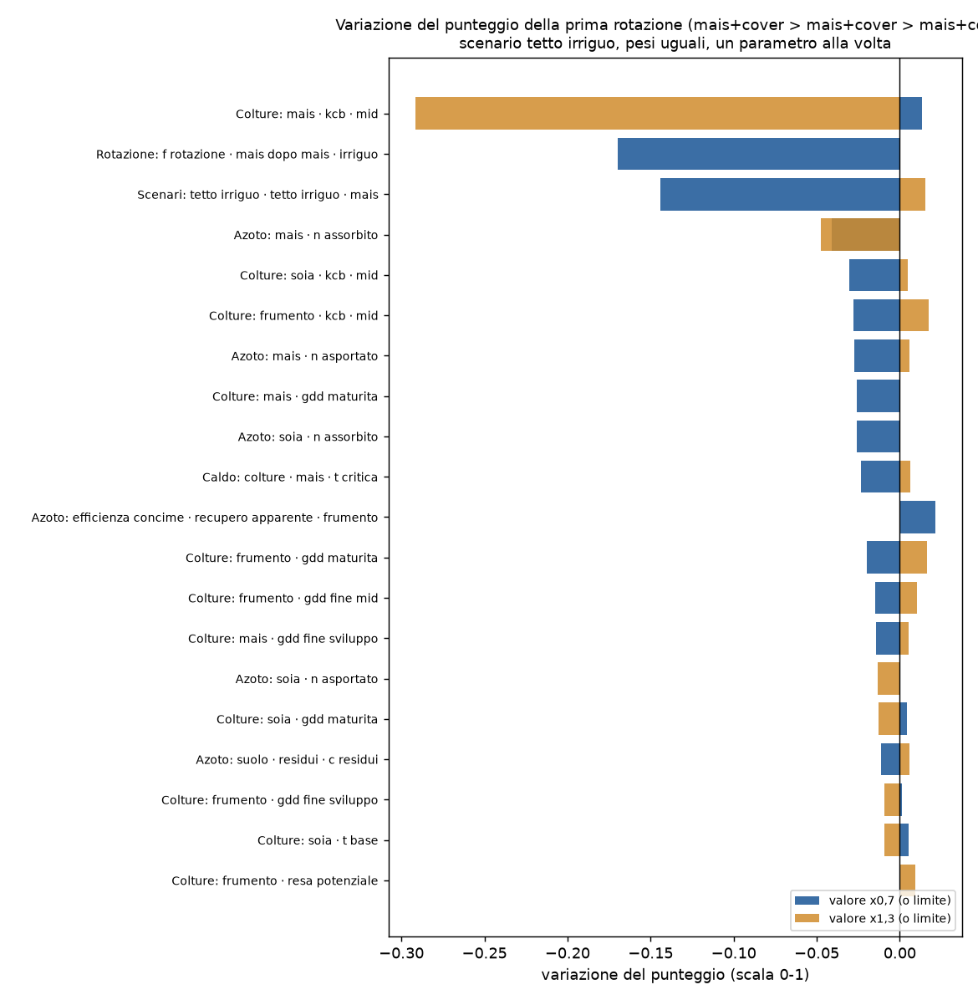
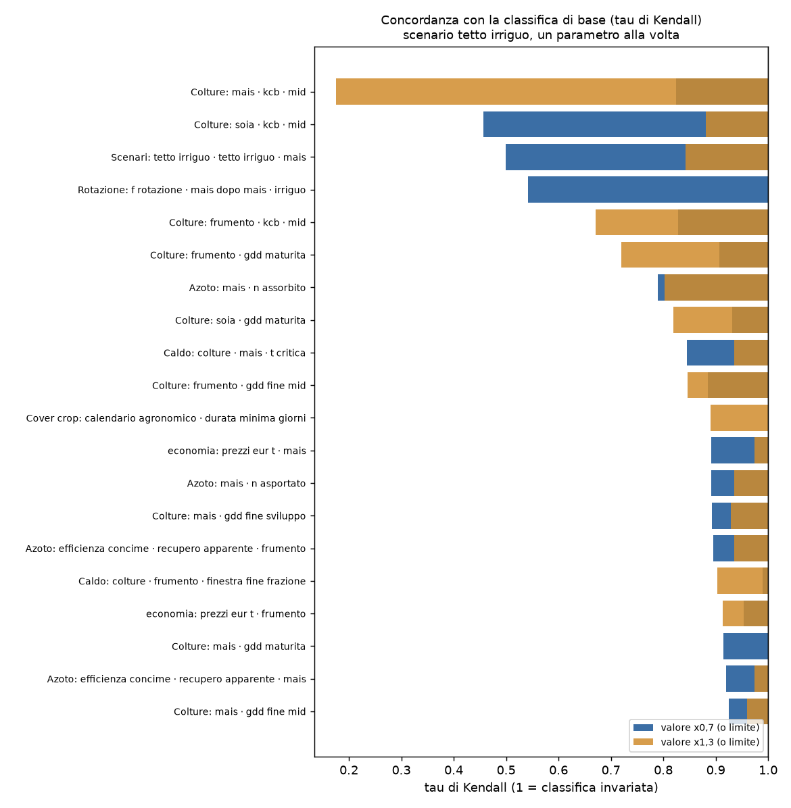
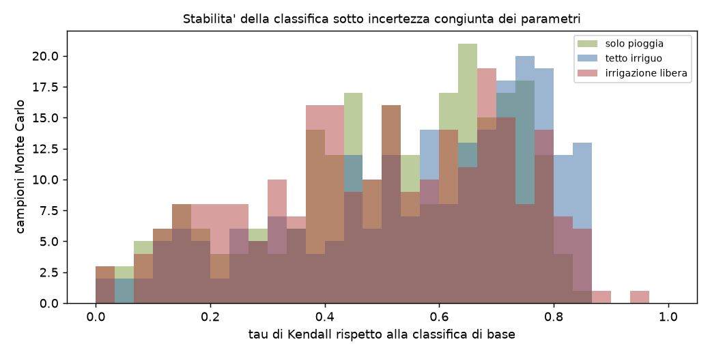

# Analisi di sensibilita' (fase 7)

Generato da `python -m fieldwise.sensitivity` il 2026-11-14. Domanda: quali parametri incerti cambiano la DECISIONE (classifica delle rotazioni e alternative proposte) e quali no. Nessuna taratura: si riporta cio' che esce.

## Conclusione in una frase

Cambiano la prima rotazione nel tetto irriguo 9 dei 179 parametri presi uno alla volta (soprattutto `crops.mais.kcb.mid`, `rotation_rules.f_rotazione.mais_dopo_mais.irriguo`, `scenarios.scenari.tetto_irriguo.tetto_irriguo.mais`, `nitrogen.mais.n_assorbito`, `crops.soia.kcb.mid`) e, tra le scelte strutturali, curve number per copertura; riparto dell'azoto assorbito su eta; riparto dell'azoto assorbito su eta/et0; penalita' di rotazione azzerate; non cambiano la decisione 122 parametri (82 senza alcun effetto); con l'incertezza congiunta la prima resta prima solo nel 12% dei campioni (tau mediano 0.58) ma il mais continuo resta nell'ultimo quarto nel 51%: e' robusto il giudizio sulla rotazione attuale, non la scelta fine tra le prime alternative.

## Metodo

- **Versione del codice**: commit 39ed21a con modifiche locali in src/ o params/ non registrate, hash dei parametri b14f7230bb3d9b0a78d480d3e2996f23081c4767c66a365823c167ea18e512d3, ensemble calcolato il 2026-11-14T15:50:28+00:00.
- **Sottoinsieme fisso**: tutti i membri (125 rotazioni) delle 45 classi cicliche non equivalenti dell'ensemble di base, tutte le annate, i tre scenari d'acqua, rotazione attuale "mais". Le equivalenze sono fissate sul caso di base.
- **Verifica del sottoinsieme** (classifica di base, pesi uguali, contro l'ensemble completo di 216 rotazioni): solo pioggia tau 1.000, stessa prima si, stesse prime tre si; tetto irriguo tau 1.000, stessa prima si, stesse prime tre si; irrigazione libera tau 1.000, stessa prima si, stesse prime tre si.
- **Indicatore principale**: punteggio a pesi uguali di `ranking.score` nello scenario tetto irriguo; in subordine solo pioggia e irrigazione libera. Il punteggio e' relativo all'insieme confrontato (0-1).
- **Una alla volta**: 179 voci di `params.sensitivity_entries` a x0,7 e x1,3 del valore. Limiti: l'`intervallo` della voce se piu' stretto; 1 per frazioni, quote ed efficienze; soglie ordinate (GDD delle fasi, zr iniziale < massima, t critica < t limite, finestre del caldo, soglie di pioggia) con la successiva >= precedente x1.01. Valori interi arrotondati. Escluse 6 voci: `crops.mais.irrigabile` (interruttore 0/1, non una grandezza continua); `crops.soia.irrigabile` (interruttore 0/1, non una grandezza continua); `crops.frumento.t_base` (valore nullo: +/-30% non lo cambia); `nitrogen.soia.credito_precessione` (valore nullo: +/-30% non lo cambia); `scenarios.scenari.solo_pioggia.tetto_irriguo.mais` (valore nullo: +/-30% non lo cambia); `scenarios.scenari.solo_pioggia.tetto_irriguo.soia` (valore nullo: +/-30% non lo cambia).
- **Soglie 'non conta'**: in nessuno dei tre scenari cambia la prima, l'insieme delle prime tre o le alternative; |variazione del punteggio della prima| < 0.01; tau >= 0.95.
- **Funzione del caldo alternativa**: si seleziona con l'argomento `metodo_caldo` di `ensemble.run_ensemble` e `rotation.simulate` (`yield_model.heat_factor` con `metodo` diverso).
- **Monte Carlo**: 256 campioni a ipercubo latino (`scipy.stats.qmc.LatinHypercube`, seme 20261113) su tutte le 179 voci, uniformi tra gli stessi limiti dell'OAT; 214 campioni corretti per le soglie ordinate; 0 non eseguibili. Con 179 parametri e 256 campioni l'influenza si stima con correlazioni di rango parziali (PRCC, gradi di liberta' residui 75): indicativa, non un indice di Sobol.
- **Tempo di calcolo**: OAT + strutturali 231 s (335 calcoli), Monte Carlo 166 s, totale 409 s con 8 processi.

## Caso di base

- solo pioggia: prime tre `frumento+cover > soia+cover > mais`, `frumento > frumento+cover > soia`, `frumento+cover > soia > mais`; attuale `mais > mais > mais` 45a su 45; alternative `frumento+cover > soia+cover > mais`, `frumento > frumento+cover > soia`
- tetto irriguo: prime tre `mais+cover > mais+cover > mais+cover`, `mais+cover > mais+cover > mais`, `frumento+cover > mais+cover > mais`; attuale `mais > mais > mais` 13a su 45; alternative `mais+cover > mais+cover > mais+cover`, `frumento+cover > mais > mais`
- irrigazione libera: prime tre `mais+cover > mais+cover > soia+cover`, `mais+cover > mais+cover > soia`, `mais+cover > mais+cover > mais+cover`; attuale `mais > mais > mais` 27a su 45; alternative `mais+cover > mais+cover > soia+cover`, `mais+cover > mais+cover > soia`

## I 20 parametri piu' influenti (una alla volta, tetto irriguo)

Effetto = variazione del punteggio della prima rotazione di base; tau = minimo sui due lati; 'prima'/'top3'/'alt' = cambia la prima, l'insieme delle prime tre, le alternative (T = tetto irriguo, S = solo pioggia, L = irrigazione libera).

Ord. | Parametro | Base | Valore -30% | Valore +30% | Effetto -30% | Effetto +30% | Attuale -/+ | tau | prima | top3 | alt | limiti
---|---|---|---|---|---|---|---|---|---|---|---|---
1 | `crops.mais.kcb.mid` | 1.15 | 0.805 | 1.495 | +0.013 | -0.292 | +0.00/-0.29 | 0.18 | TS | TSL | TS | -
2 | `rotation_rules.f_rotazione.mais_dopo_mais.irriguo` | 0.983 | 0.862 | 0.983 | -0.170 | +0.000 | -0.17/+0.00 | 0.54 | TL | TL | TL | intervallo
3 | `scenarios.scenari.tetto_irriguo.tetto_irriguo.mais` | 200 | 140 | 260 | -0.144 | +0.015 | -0.15/+0.01 | 0.50 | T | T | T | -
4 | `nitrogen.mais.n_assorbito` | 22.7 | 15.89 | 29.51 | -0.041 | -0.048 | -0.04/-0.02 | 0.79 | TS | TSL | TSL | -
5 | `crops.soia.kcb.mid` | 1.1 | 0.77 | 1.43 | -0.031 | +0.005 | -0.03/+0.00 | 0.46 | TSL | TSL | TSL | -
6 | `crops.frumento.kcb.mid` | 1.1 | 0.77 | 1.43 | -0.028 | +0.018 | -0.02/+0.01 | 0.67 | TS | TS | TSL | -
7 | `nitrogen.mais.n_asportato` | 15.6 | 10.92 | 20.28 | -0.028 | +0.006 | -0.01/+0.01 | 0.89 | T | TSL | TL | -
8 | `crops.mais.gdd_maturita` | 1950 | 1515 | 1950 | -0.026 | +0.000 | -0.01/+0.00 | 0.92 | SL | T | TSL | intervallo,ordine(meno)
9 | `nitrogen.soia.n_assorbito` | 78.7 | 63 | 78.7 | -0.026 | +0.000 | -0.02/+0.00 | 0.93 | - | S | - | intervallo
10 | `heat.colture.mais.t_critica` | 32 | 30 | 35 | -0.023 | +0.006 | -0.03/+0.01 | 0.84 | TS | TL | TS | intervallo
11 | `nitrogen.efficienza_concime.recupero_apparente.frumento` | 0.57 | 0.399 | 0.741 | +0.022 | -0.000 | +0.02/-0.00 | 0.89 | S | T | S | -
12 | `crops.frumento.gdd_maturita` | 2395 | 1762 | 3114 | -0.020 | +0.016 | -0.01/-0.00 | 0.72 | - | TSL | TSL | ordine(meno)
13 | `crops.frumento.gdd_fine_mid` | 1745 | 1222 | 2250 | -0.015 | +0.010 | -0.01/+0.01 | 0.85 | - | S | T | intervallo
14 | `crops.mais.gdd_fine_sviluppo` | 670 | 469 | 871 | -0.014 | +0.005 | -0.01/+0.00 | 0.89 | - | T | TL | -
15 | `nitrogen.soia.n_asportato` | 57.5 | 57.5 | 63.4 | +0.000 | -0.013 | +0.00/-0.01 | 0.98 | - | - | - | intervallo
16 | `crops.soia.gdd_maturita` | 2470 | 2150 | 3211 | +0.004 | -0.013 | +0.01/+0.01 | 0.82 | L | TSL | L | intervallo
17 | `nitrogen.suolo.residui.c_residui` | 0.45 | 0.315 | 0.585 | -0.011 | +0.006 | -0.01/+0.01 | 0.98 | - | - | - | -
18 | `crops.frumento.gdd_fine_sviluppo` | 1105 | 774 | 1436 | +0.001 | -0.009 | +0.00/-0.01 | 0.93 | - | T | T | -
19 | `crops.soia.t_base` | 5 | 3.5 | 6.5 | +0.005 | -0.009 | +0.00/-0.01 | 0.94 | S | S | SL | -
20 | `crops.frumento.resa_potenziale` | 8 | 7 | 9 | -0.000 | +0.009 | -0.00/+0.01 | 0.96 | S | - | S | intervallo

Fuori dai primi 20 per effetto ma con tau < 0.95 nel tetto irriguo: `crops.mais.gdd_fine_mid` (0.93), `heat.colture.frumento.finestra_fine_frazione` (0.90), `nitrogen.suolo.residui.giorni_rilascio` (0.95), `nitrogen.suolo.temperatura.q10` (0.94), `nitrogen.efficienza_concime.recupero_apparente.mais` (0.92), `heat.colture.mais.finestra_fine_frazione` (0.94), `cover_crop.calendario_agronomico.durata_minima_giorni` (0.89), `crops.suolo_nudo.ze` (0.94), `nitrogen.frumento.n_assorbito` (0.95), `heat.colture.mais.t_limite` (0.95), `nitrogen.frumento.n_asportato` (0.94), `scenarios.scenari.tetto_irriguo.tetto_irriguo.soia` (0.95), `heat.colture.soia.t_limite` (0.95), `economia.prezzi_eur_t.mais` (0.89), `economia.prezzi_eur_t.frumento` (0.91), `economia.prezzi_eur_t.soia` (0.94).

Variazioni non eseguibili: nessuna.

## Incertezza strutturale (una alla volta)

Scelta | Esito | tau T / S / L | Effetto sulla prima (T) | Prima nel tetto irriguo | Cambia prima T/S/L | Cambiano top3 T/S/L | Cambiano alternative T/S/L
---|---|---|---|---|---|---|---
Funzione del caldo AquaCrop (Ks logistico su Tmax) | ok | 0.96 / 0.95 / 0.94 | +0.006 | `mais+cover > mais+cover > mais+cover` | no/no/no | no/no/no | no/no/no
Funzione del caldo con soglie di Teixeira et al. (2013) | ok | 0.96 / 0.94 / 0.94 | +0.006 | `mais+cover > mais+cover > mais+cover` | no/no/no | no/no/no | no/no/no
Evapotraspirazione a Kc singolo | ok | 0.87 / 0.86 / 0.92 | -0.002 | `mais+cover > mais+cover > mais+cover` | no/no/no | si/no/no | si/no/no
Curve Number per copertura (NEH) al posto di AquaCrop | ok | 0.72 / 0.81 / 0.87 | -0.003 | `mais+cover > mais+cover > mais+cover` | si/no/no | si/si/si | si/si/no
Riparto dell'azoto assorbito su ETa | ok | 0.93 / 0.93 / 0.90 | -0.008 | `mais+cover > mais+cover > mais+cover` | si/no/no | si/no/no | si/no/no
Riparto dell'azoto assorbito su ETa/ET0 | ok | 0.88 / 0.86 / 0.84 | -0.025 | `frumento+cover > mais+cover > mais` | si/si/no | si/si/si | si/si/no
Zero cicli di avviamento | ok | 0.84 / 0.91 / 0.92 | +0.004 | `mais+cover > mais+cover > mais+cover` | no/no/no | no/no/no | no/si/no
Pioggia IMERG al posto di NASA POWER | ok | 0.84 / 0.78 / 0.91 | -0.000 | `mais+cover > mais+cover > mais+cover` | no/no/no | si/si/no | si/si/no
Penalita' di rotazione azzerate (tutti i fattori = 1) | ok | 0.32 / 0.75 / 0.44 | -0.028 | `mais+cover > mais+cover > mais+cover` | si/no/si | si/si/si | si/si/si
Sostanza organica 0-30 cm al valore SoilGrids (3,563%) | ok | 0.93 / 0.98 / 0.98 | -0.000 | `mais+cover > mais+cover > mais+cover` | no/no/no | no/no/no | no/no/no

## Monte Carlo (incertezza congiunta dei parametri)

Scenario | campioni validi | tau mediana | tau 5° perc. | prima resta prima | prime tre restano | attuale nell'ultimo quarto | alternative restano
---|---|---|---|---|---|---|---
solo pioggia | 256 | 0.524 | 0.074 | 12.9% | 0.8% | 86.7% | 2.7%
tetto irriguo | 256 | 0.581 | -0.218 | 11.7% | 2.0% | 51.2% | 0.0%
irrigazione libera | 256 | 0.505 | 0.097 | 29.7% | 9.0% | 69.5% | 13.3%

Frequenza con cui le rotazioni compaiono tra le prime tre (le prime 6 per scenario):

- solo pioggia: `frumento > frumento+cover > soia` 39%; `frumento > frumento+cover > mais` 36%; `frumento+cover > soia+cover > mais` 27%; `frumento+cover > mais+cover > soia` 25%; `frumento+cover > mais+cover > mais` 22%; `frumento+cover > soia+cover > soia` 22%
- tetto irriguo: `frumento+cover > mais+cover > mais` 50%; `frumento > mais+cover > mais` 31%; `frumento+cover > soia+cover > mais` 29%; `frumento+cover > mais+cover > soia` 23%; `frumento > frumento+cover > mais` 21%; `mais+cover > mais+cover > mais+cover` 19%
- irrigazione libera: `mais+cover > mais+cover > soia+cover` 51%; `mais+cover > mais+cover > soia` 36%; `frumento+cover > soia+cover > mais` 32%; `frumento+cover > mais+cover > soia` 28%; `mais+cover > soia+cover > soia+cover` 23%; `mais+cover > mais+cover > mais+cover` 17%

Parametri con le correlazioni di rango parziali piu' forti (tetto irriguo; |PRCC| piu' alto su punteggio della prima e tau):

- `crops.mais.kcb.mid`: PRCC punteggio della prima -0.69, PRCC tau -0.55
- `crops.soia.kcb.mid`: PRCC punteggio della prima +0.47, PRCC tau +0.60
- `rotation_rules.f_rotazione.mais_dopo_mais.irriguo`: PRCC punteggio della prima +0.58, PRCC tau +0.49
- `scenarios.scenari.tetto_irriguo.tetto_irriguo.mais`: PRCC punteggio della prima +0.42, PRCC tau +0.21
- `crops.frumento.gdd_maturita`: PRCC punteggio della prima +0.41, PRCC tau -0.17
- `heat.colture.mais.finestra_inizio_frazione`: PRCC punteggio della prima -0.33, PRCC tau -0.04
- `nitrogen.efficienza_concime.recupero_apparente.frumento`: PRCC punteggio della prima -0.33, PRCC tau -0.03
- `crops.frumento.kc.ini`: PRCC punteggio della prima +0.31, PRCC tau +0.12
- `economia.prezzi_eur_t.mais`: PRCC punteggio della prima +0.19, PRCC tau +0.30
- `heat.colture.frumento.finestra_fine_frazione`: PRCC punteggio della prima +0.30, PRCC tau +0.15

## Sensibilita' ai pesi dell'utente (non e' incertezza del modello)

Parametri di base; 5 casi estremi (tutto il peso su una priorita') e 200 pesi casuali (Dirichlet uniforme sul simplesso, stesso seme).

- solo pioggia: 14 rotazioni diverse arrivano prime (10 con i pesi casuali). Estremi: resa -> `frumento > frumento > soia`; rischio -> `frumento > frumento > soia`; acqua -> `frumento > frumento > frumento` (avviso: le rotazioni non si distinguono); concime -> `soia > soia > soia`; suolo -> `mais+cover > mais+cover > mais+cover`; profitto -> `mais+cover > mais > mais`. Piu' frequenti: `frumento > frumento+cover > soia` 44%; `soia+cover > soia+cover > soia+cover` 15%; `mais+cover > mais+cover > mais+cover` 14%
- tetto irriguo: 15 rotazioni diverse arrivano prime (12 con i pesi casuali). Estremi: resa -> `frumento > mais > mais`; rischio -> `frumento+cover > mais > mais`; acqua -> `frumento > frumento > frumento`; concime -> `soia > soia > soia`; suolo -> `mais+cover > mais+cover > mais+cover`; profitto -> `mais+cover > mais+cover > mais`. Piu' frequenti: `mais+cover > mais+cover > mais+cover` 55%; `frumento+cover > mais+cover > mais` 13%; `frumento > frumento+cover > soia` 12%
- irrigazione libera: 16 rotazioni diverse arrivano prime (13 con i pesi casuali). Estremi: resa -> `frumento > mais > soia`; rischio -> `mais > mais > soia`; acqua -> `frumento > frumento > frumento`; concime -> `soia > soia > soia`; suolo -> `mais+cover > mais+cover > mais+cover`; profitto -> `mais+cover > mais+cover > mais+cover`. Piu' frequenti: `mais+cover > mais+cover > mais+cover` 32%; `mais+cover > mais+cover > soia+cover` 28%; `frumento > frumento+cover > soia` 12%

## Parametri che NON contano

**Senza alcun effetto sul risultato** (82; voci non usate dal motore nella configurazione di base, per esempio i parametri delle sole alternative strutturali): `nitrogen.soia.nhi`, `rotation_rules.f_rotazione.mais_dopo_mais.asciutto.primo_ristoppio`, `cover_crop.humus.incremento_c_suolo_medio`, `crops.mais.kc.ini`, `rotation_rules.precessione_favorevole.cereale_dopo_leguminosa_vs_monosuccessione`, `crops.mais.kc.end`, `crops.mais.gdd_fioritura`, `rotation_rules.f_rotazione.mais_dopo_mais.asciutto.monosuccessione_continua`, `crops.soia.gdd_fioritura`, `crops.soia.kc.ini`, `nitrogen.suolo.fattore_dispersione.tendenzialmente_argilloso[2]`, `crops.frumento.kc.ini`, `crops.frumento.gdd_fioritura`, `nitrogen.lisciviazione.metodo_disciplinare.perdita_uscita_inverno`, `nitrogen.lisciviazione.metodo_disciplinare.soglie_pioggia_autunno_inverno[1]`, `nitrogen.lisciviazione.metodo_disciplinare.soglie_pioggia_autunno_inverno[0]`, `crops.frumento.gdd_emergenza`, `cover_crop.biomassa_e_azoto.efficienza_campo`, `soil.strati_soilgrids.s0_30.sabbia`, `soil.strati_soilgrids.s0_30.argilla`, `soil.strati_soilgrids.s0_30.carbonio_organico`, `soil.drenaggio.tau_alternativa.strato_profondo`, `soil.drenaggio.tau_alternativa.strato_superficiale`, `soil.ruscellamento.neh.ia_su_s`, `cover_crop.acqua.kcb.mid`, `cover_crop.acqua.kcb.end`, `soil.profilo.acqua_disponibile_totale`, `soil.profilo.strato_profondo.ksat`, `soil.profilo.strato_superficiale.ksat`, `soil.profilo.profondita_profilo`, `soil.strati_soilgrids.s100_200.ksat`, `soil.strati_soilgrids.s100_200.frammenti_grossolani`, `soil.strati_soilgrids.s30_100.ksat`, `soil.strati_soilgrids.s30_100.frammenti_grossolani`, `soil.strati_soilgrids.s0_30.ksat`, `soil.strati_soilgrids.s0_30.frammenti_grossolani`, `cover_crop.biomassa_e_azoto.riduzione_lisciviazione`, `cover_crop.biomassa_e_azoto.quota_n_che_torna_alla_coltura_successiva`, `heat.alternative.aquacrop.delta_zero`, `nitrogen.suolo.fattore_dispersione.tendenzialmente_argilloso[1]`, `nitrogen.mais.credito_precessione.stocchi_asportati`, `nitrogen.suolo.k2.cn_basso.tendenzialmente_sabbioso`, `nitrogen.suolo.k2.formula_machet.coeff_temperatura[1]`, `nitrogen.suolo.k2.formula_machet.coeff_temperatura[0]`, `nitrogen.suolo.k2.formula_machet.coeff_numeratore`, `nitrogen.suolo.k2.cn_alto.tendenzialmente_argilloso`, `nitrogen.suolo.k2.cn_alto.franco`, `nitrogen.suolo.k2.cn_alto.tendenzialmente_sabbioso`, `nitrogen.suolo.k2.cn_basso.tendenzialmente_argilloso`, `nitrogen.suolo.k2.cn_basso.franco`, `nitrogen.suolo.k2.per_tessitura.tendenzialmente_argilloso`, `nitrogen.suolo.fattore_dispersione.tendenzialmente_argilloso[0]`, `heat.alternative.teixeira_2013.t_limite_mais`, `nitrogen.suolo.k2.per_tessitura.tendenzialmente_sabbioso`, `nitrogen.frumento.credito_precessione.paglia_asportata`, `heat.alternative.teixeira_2013.t_critica_frumento`, `heat.alternative.teixeira_2013.t_limite_frumento`, `heat.alternative.teixeira_2013.t_critica_soia`, `heat.alternative.teixeira_2013.t_limite_soia`, `nitrogen.soia.fissazione.coeff_inibizione_n`, `nitrogen.suolo.n_mineralizzato_disciplinare.tendenzialmente_sabbioso[0]`, `nitrogen.suolo.n_mineralizzato_disciplinare.tendenzialmente_sabbioso[1]`, `nitrogen.suolo.n_mineralizzato_disciplinare.tendenzialmente_sabbioso[2]`, `nitrogen.suolo.n_mineralizzato_disciplinare.franco[0]`, `heat.alternative.aquacrop.tx_heat_mais`, `nitrogen.suolo.fattore_dispersione.franco[1]`, `nitrogen.suolo.fattore_dispersione.franco[0]`, `nitrogen.suolo.fattore_dispersione.tendenzialmente_sabbioso[2]`, `nitrogen.suolo.fattore_dispersione.tendenzialmente_sabbioso[1]`, `nitrogen.suolo.fattore_dispersione.tendenzialmente_sabbioso[0]`, `nitrogen.suolo.n_pronto.tendenzialmente_argilloso`, `nitrogen.suolo.n_pronto.franco`, `nitrogen.suolo.n_pronto.tendenzialmente_sabbioso`, `heat.alternative.aquacrop.tx_heat_soia`, `heat.alternative.aquacrop.tx_heat_frumento`, `heat.alternative.teixeira_2013.t_critica_mais`, `nitrogen.suolo.n_mineralizzato_disciplinare.tendenzialmente_argilloso[2]`, `nitrogen.suolo.n_mineralizzato_disciplinare.tendenzialmente_argilloso[1]`, `nitrogen.suolo.n_mineralizzato_disciplinare.tendenzialmente_argilloso[0]`, `nitrogen.suolo.n_mineralizzato_disciplinare.franco[2]`, `nitrogen.suolo.n_mineralizzato_disciplinare.franco[1]`, `cover_crop.acqua.kc`.

**Con effetto ma senza conseguenze sulla decisione** (42; nessun cambio di prima, prime tre o alternative in alcuno scenario, |effetto| < 0.01, tau >= 0.95): `nitrogen.mais.k1_residui`, `cover_crop.acqua.kcb.ini`, `nitrogen.suolo.fattore_so_c`, `nitrogen.suolo.n_humus`, `soil.strati_soilgrids.s0_30.densita_apparente`, `nitrogen.soia.k1_residui`, `nitrogen.suolo.profondita_humus`, `soil.strati_soilgrids.s0_30.sostanza_organica`, `nitrogen.deposizione_atmosferica`, `crops.soia.kcb.end`, `heat.colture.frumento.t_critica`, `nitrogen.lisciviazione.anion_excl`, `crops.soia.kcb.ini`, `nitrogen.suolo.fattore_dispersione.franco[2]`, `nitrogen.suolo.k2.per_tessitura.franco`, `heat.colture.frumento.finestra_inizio_frazione`, `heat.colture.frumento.t_limite`, `cover_crop.acqua.profondita_radicale_iniziale`, `crops.soia.zr_max`, `cover_crop.humus.coefficiente_isoumico`, `cover_crop.biomassa_e_azoto.frazione_carbonio_sostanza_secca`, `nitrogen.soia.fissazione.quota_fissazione_max`, `rotation_rules.calendario_rotazione.giorni_minimi_raccolta_semina`, `crops.frumento.kcb.end`, `nitrogen.mais.credito_precessione.stocchi_interrati`, `rotation_rules.f_rotazione.soia_dopo_soia`, `cover_crop.biomassa_e_azoto.biomassa_secca`, `crops.frumento.gdd_fine_ini`, `rotation_rules.f_rotazione.frumento_dopo_frumento.monosuccessione_continua`, `cover_crop.acqua.profondita_radicale_max`, `cover_crop.biomassa_e_azoto.npd_per_t_ss`, `crops.frumento.kcb.ini`, `nitrogen.frumento.credito_precessione.paglia_interrata`, `heat.colture.soia.finestra_fine_frazione`, `crops.soia.zr_ini`, `crops.mais.gdd_emergenza`, `crops.frumento.zr_max`, `crops.frumento.zr_ini`, `crops.soia.gdd_emergenza`, `cover_crop.acqua.altezza`, `soil.umidita_iniziale.frazione_acqua_disponibile`, `economia.irrigazione_eur_mm`.

