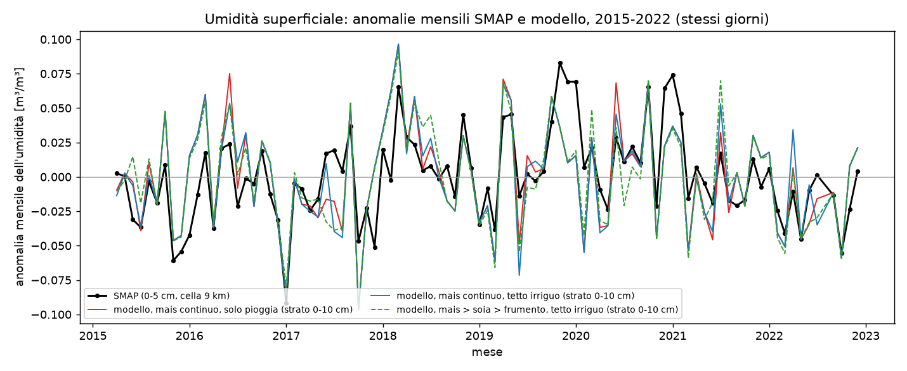
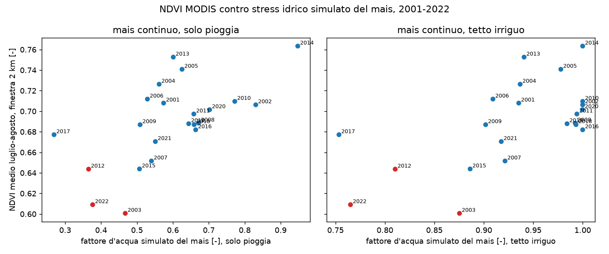
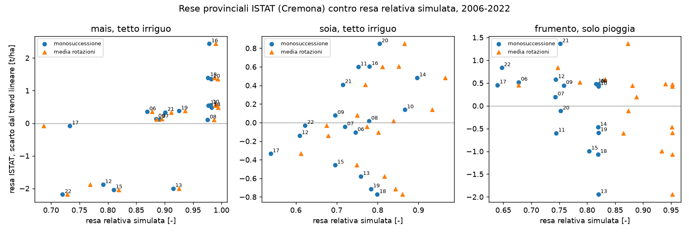
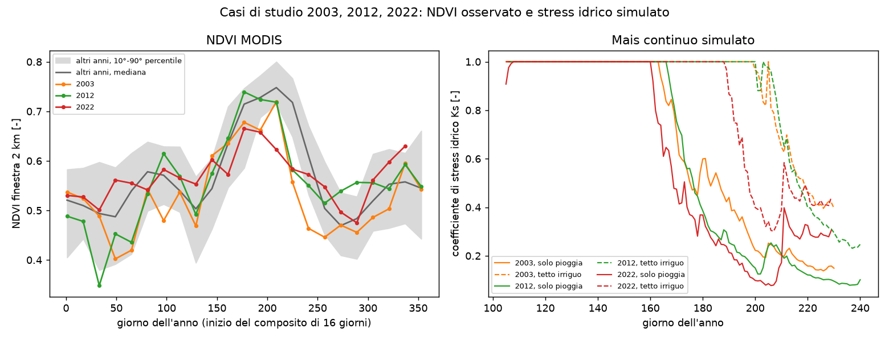
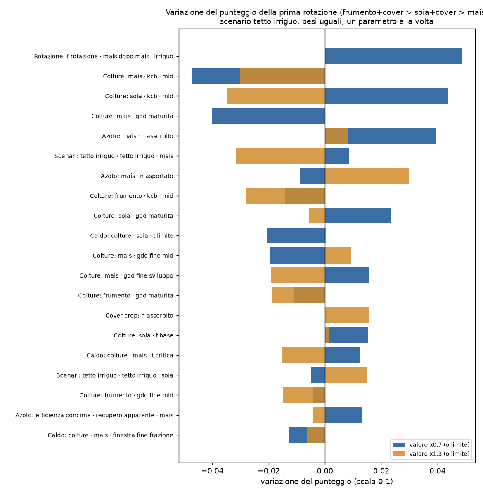
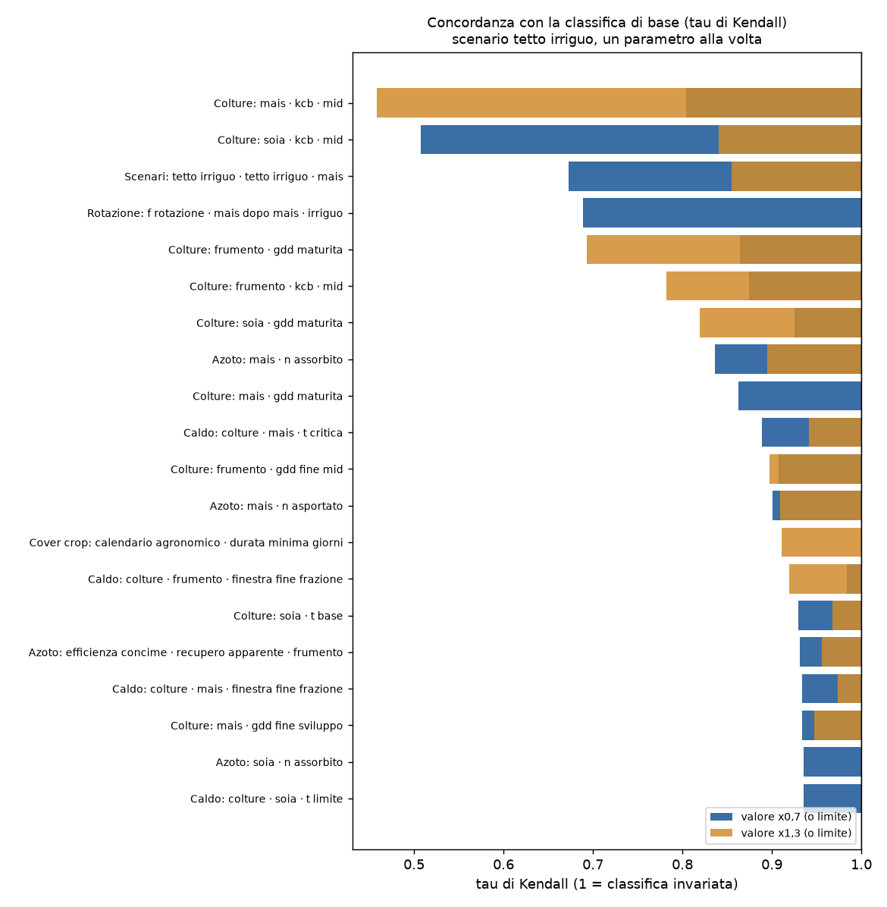
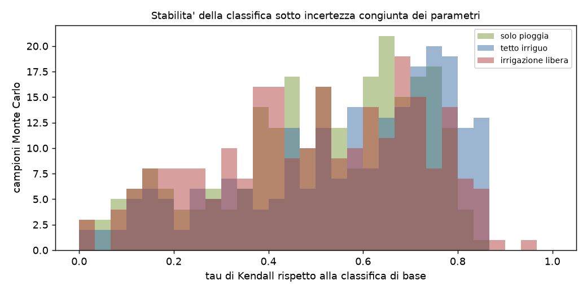

# FIELDWISE - report per il team

*NASA Space Apps Challenge 2026 - Field Shift: Adapting Farms with NASA Data.* Punto pilota lat 45,2, lon 10,0 (provincia di Cremona). Stato del 2026-11-13. Questo documento aggiorna la proposta di modello che avevamo discusso (`legacy/FIELDWISE_proposta_modello.pdf`) con quello che il codice fa adesso, con i risultati veri e con quello che non funziona.

**Dove leggere i numeri.** Tutti i risultati di questo report sono letti dai file in `data/processed/` al momento della generazione (`reports/build_report.py`): ensemble calcolato il 2026-11-13, hash dei parametri 2b8a878cc861. Rilanciare lo script dopo ogni nuovo ensemble. Le pagine di dettaglio sono `reports/validation.md`, `reports/sensitivity.md`, `reports/engine_review.md`, `data/CHECKS.md` e `PLAN.md`.

## In breve

- Teniamo l'idea di Lorenzo: ogni coltura eredita il suolo lasciato dalla precedente; lo stato del suolo non si azzera mai.
- Al posto dei vettori dinamici ci sono bilanci di massa di acqua, azoto e humus a passo giornaliero, con le formule di FAO-56, FAO-33 e AquaCrop. Ogni parametro ha una fonte e un campo `verificato`.
- L'ensemble prova 216 rotazioni su 17 annate di partenza (meteo reale NASA POWER) in tre scenari d'acqua: 11.016 simulazioni riuscite in 6.7 s.
- Validazione contro osservazioni: il mais regge (resa ISTAT), la soia no, il frumento va nella direzione sbagliata (sezione 10). Questo pesa su come leggere le classifiche.
- La prima rotazione della classifica cambia con molti parametri incerti; il giudizio sul mais continuo (nell'ultimo quarto della classifica nel 92%-99% dei campioni) invece regge, con una sfumatura: nel caso di base il mais continuo è 45a su 45 (solo pioggia), 30a su 45 (tetto irriguo), 43a su 45 (irrigazione libera) (sezione 11).

## Cosa è cambiato rispetto alla proposta originale

La proposta era una prima versione non tarata. Strada facendo abbiamo corretto errori e preso decisioni che cambiano i numeri: le righe in grassetto sono quelle che si notano di più.

| Tema | Proposta originale | Ora |
|---|---|---|
| Meteo | NASA POWER 2000-2025, 23 annate. | POWER 2000-2022: la pioggia POWER 2023-2025 è sovrastimata (rapporto con il pluviometro 1,02 fino al 2022, 1,46 dopo; `data/CHECKS.md` D1). Con un ciclo di avviamento restano 17 annate di partenza (2000-2016). |
| ET0 | Hargreaves (solo temperature). | Penman-Monteith FAO-56 con radiazione, umidità e vento di POWER. |
| **Acqua** | Kc singolo, un solo strato di 1,5 m, ruscellamento oltre 60 mm/giorno. | **Doppio coefficiente** FAO-56 (Kcb + Ke) per tutte le superfici, strato evaporante a parte, Curve Number di AquaCrop (72, Ia = 0,05 S). |
| Fasi | Giorni fissi. | Gradi-giorno da POWER. |
| **Azoto** | Aggiornato a fine segmento. | **Passo giornaliero** (`PLAN.md` D14): a fine segmento la cover aumentava la lisciviazione e sotto il frumento la lisciviazione risultava zero. |
| Resa | FAO-33 sull'acqua e basta. | Resa = potenziale x f_acqua x f_caldo x f_rotazione (sezione 4). |
| Rotazione | Nessuna penalità. | Penalità di ristoppio da letteratura; conformità ai disciplinari come etichetta, nessuna rotazione esclusa. |
| **Cover crop** | Dimezza o più la lisciviazione (57 a 19 kg N/ha/anno, mais continuo irriguo). | **Riduce meno**: mais continuo con cover ogni anno, lisciviazione 21,0 a 15,7 kg N/ha/anno in irrigazione libera (25%). Per singolo intervallo la riduzione è 51% dopo il mais e 62% dopo il frumento (`PLAN.md`). |
| Suolo | Franco di default, 2% di sostanza organica. | Tessitura e densità SoilGrids; sostanza organica 0-30 cm ERSAF 2,33% (SoilGrids dà 3,56%, in sensibilità); acqua disponibile 213,6 mm su 1,5 m. |
| **Primi risultati** | Irrigazione libera: mais continuo 320 mm e 283 kg N; mais > soia > frumento 213 mm e 157 kg N. | Irrigazione libera: mais continuo 294 mm e 302 kg N; mais > soia > frumento 197 mm e 174 kg N (sezione 9, letti dalla cache). |
| Caldo 2022 | "Una penalità termica farebbe emergere il 2022". | Penalità aggiunta (Deryng et al. 2014) senza taratura: il criterio non è soddisfatto, f_caldo 0,958 nel 2022 (`PLAN.md` D16). La perdita del 2022 nel modello viene dall'acqua. |
| Validazione | Da fare (SMAP, NDVI, ISTAT). | Fatta: mais confermato, soia non confermata, frumento negativo. |
| Parametri | "Indicativi, da verificare". | 372 voci, ognuna con fonte; 26 dichiarate assunzioni, 50 non verificate sulla fonte (`python -m fieldwise.params --check`). |

## 1. Il problema dei vettori dinamici

L'idea di partenza descriveva suolo e coltura come due traiettorie, F(t) = [W, N, T, OM] e C(t) = [Wr, Nr, Tr, R], e misurava la compatibilità come somma pesata di punteggi istantanei. Resta valido il giudizio della proposta: il punteggio non ha unità di misura (i pesi li sceglieremmo noi e non si può verificare con un satellite o con una resa reale); suolo e coltura non sono indipendenti (la pianta consuma l'acqua oggi e domani il suolo è diverso); la risposta della pianta non è lineare (soglie ed eccessi). Le equazioni non si inventano: vengono dai bilanci di massa. Il gradiente non serve per scegliere tra mais, soia e frumento (scelta discreta, si provano tutte le combinazioni).

**Cosa teniamo.** L'intuizione più forte del documento originale: il terreno cambia dopo ogni coltura e la successiva parte da lì. Nel motore lo stato non viene mai azzerato tra una coltura e l'altra. È un principio del progetto (`PLAN.md`, principio 4).

## 2. Il modello FAO

**FAO-56** (Allen et al., 1998): l'ET0 è l'acqua che evapora da un prato di riferimento, solo dal meteo; la coltura consuma ETc = Kc x ET0; l'acqua utilizzabile dalle radici è TAW (differenza tra capacità di campo e punto di appassimento per la profondità radicale); la pianta consuma senza fatica fino alla soglia RAW = p x TAW, poi Ks scende linearmente a zero e ETa = Ks x ETc. **FAO-33** (Doorenbos e Kassam, 1979): 1 - Y/Ymax = Ky x (1 - ETa/ETc), un coefficiente per coltura (Ky: mais 1,25, soia 0,85, frumento 1,05, da `params/crops.yaml`).

**Cosa è diverso da prima.** L'ET0 è Penman-Monteith (con POWER il totale annuo medio 2000-2022 è 890 mm, `data/CHECKS.md` D2; Hargreaves sovrastima del 17% in media). Il coefficiente colturale è *doppio*: Kcb per la traspirazione più Ke per l'evaporazione dello strato superficiale, applicato anche a suolo nudo e cover crop. Prima, con Kc singolo, una cover consumava meno del suolo nudo bagnato e faceva salire la percolazione: è l'errore 1 di `reports/engine_review.md`. Il suolo ha due strati, con parametri da SoilGrids e pedotrasferimento di Saxton e Rawls. Il ruscellamento usa il Curve Number di AquaCrop (72, Ia = 0,05 S) invece della soglia dei 60 mm: con il CN del suolo nudo del NEH (91) il ruscellamento era 83-94 mm/anno, troppo (E1 della stessa revisione). Le fasi seguono i gradi-giorno. L'azoto e l'humus restano contabilità semplici, ma con coefficienti dalle fonti e non indicativi (sezione 3).

## 3. Il motore

Tre bilanci di massa, a passo giornaliero, in un ciclo unico che attraversa tutta la rotazione (calcolo compilato con numba). Il calendario di ogni rotazione (semine, fasi, raccolte) dipende solo dal meteo e si precalcola; poi un unico ciclo giornaliero dell'acqua percorre tutta la simulazione senza azzerare lo stato (`PLAN.md` D6).

| Bilancio | Come funziona | Fonti |
|---|---|---|
| Acqua | Pioggia + irrigazione - ruscellamento - ETa - drenaggio = variazione dello stato. Ks sulla zona radicale, drenaggio in cascata tra gli strati. Chiusura sotto 1e-11 mm nella verifica indipendente (`engine_review.md` sez. C) e nei test. | FAO-56 cap. 7-8; AquaCrop v7.3 (Curve Number) |
| Azoto | Mineralizzazione dell'humus + fissazione (soia) + residui + concime - assorbimento - lisciviazione; assorbimento ripartito sulla traspirazione; lisciviazione per mm drenato con la forma di SWAT. Il concime copre la domanda giorno per giorno. | Disciplinari Lombardia ed Emilia-Romagna; Salvagiotti et al. 2008; SWAT |
| Humus | Hénin-Dupuis: dH = k1 x residui - k2 x H; k2 dalla formula di Machet (tessitura, C/N). La cover aggiunge biomassa e il suo isoumico. | Mémento Agro-Transfert; BENCO |

**Cosa non fa.** L'azoto non limita la resa (il concime copre il fabbisogno e se ne conta il costo e il rischio: concime, lisciviazione, quota di annate sopra il limite di legge); non c'è la falda né la risalita capillare; il concime non passa mai dal pool di azoto minerale del suolo, quindi la lisciviazione è probabilmente sottostimata (sezione 12).

## 4. Fattori di resa: acqua, caldo, rotazione (sezione nuova)

La resa relativa di una coltura è il prodotto di tre fattori, tutti tra 0 e 1, ognuno con la sua fonte e visibile separatamente nell'output (`ensemble_dettaglio.csv`: `f_acqua`, `f_caldo`, `f_rotazione`). La resa in t/ha è questa resa relativa per il potenziale (mais 15,8, soia 4,5, frumento 8,0 t/ha; il potenziale del mais è una resa sperimentale, quello di soia e frumento è un'assunzione e le tre colture non sono perfettamente paragonabili: `reports/params_review.md`).

- **Acqua (f_acqua).** In parole: la resa cala di Ky volte la frazione di acqua che la coltura non ha potuto consumare rispetto a quella che avrebbe voluto (ETa rispetto a ETc, sommate su tutta la stagione). Fonte: FAO-33 e FAO-56 eq. 90. È il fattore che muove quasi tutto: per il mais continuo la mediana di f_acqua è 0,60 con solo pioggia, 0,94 con il tetto irriguo e 1,00 con irrigazione libera.
- **Caldo (f_caldo).** In parole: per ogni giorno della finestra della fioritura, se la temperatura efficace (media tra media e massima) supera la soglia critica, il fattore scende linearmente fino a zero alla soglia limite; il fattore è la media sulla finestra. Fonte: Deryng et al. (2014), App. A.3, usata senza taratura. Soglie critica/limite: mais 32/45 °C, soia 35/40, frumento 25/35. Alternative in sensibilità: AquaCrop (logistica sulla Tmax) e le soglie di Teixeira et al. (2013).
- **Rotazione (f_rotazione).** In parole: se la stessa coltura segue sé stessa la resa si riduce di una quota fissa. Mais dopo mais: 0,983 se irriguo; in asciutto 0,981 al primo ristoppio e 0,943 in monosuccessione continua; soia dopo soia 0,897; frumento dopo frumento 0,875 e 0,820. Fonti: Seifert et al. (2017, studio osservazionale USA su mais e soia), Marini et al. (2020) e AHDB (UK, frumento). Sono fonti di altri contesti: non c'è una prova di lungo periodo in Pianura Padana e la penalità può contenere un effetto azoto (doppio conteggio parziale; variante f_rotazione = 1 in sensibilità). La precessione favorevole non si applica alla resa.

> **Il criterio sul caldo del 2022 non è soddisfatto.** Ci aspettavamo che il fattore caldo del mais fosse chiaramente basso nel 2022. Non lo è: f_caldo vale 0,958 con le temperature POWER e circa 0,99 con le stazioni ARPA (`PLAN.md` D16, `data/CHECKS.md` D3). In tutto l'ensemble il f_caldo del mais continuo sta tra 0,972 e 0,999: il caldo in fioritura incide poco in questo clima con questa funzione. Non l'abbiamo tarata per ottenere il risultato che speravamo (sarebbe stata una taratura sul risultato). Nel modello la perdita del 2022 viene dall'acqua: nel confronto con l'NDVI f_acqua del 2022 è tra le tre peggiori del periodo (sezione 10).

## 5. La catena di rotazione

Una rotazione è una sequenza ciclica di tre colture (mais, soia, frumento), ognuna con o senza cover crop (segale) nell'intervallo dopo il raccolto: 216 rotazioni, 76 classi cicliche per scenario (la stessa sequenza partita da un altro anno è la stessa classe) di cui 45 non equivalenti (le altre sono equivalenti perché la cover non è praticabile e il risultato è identico). Ogni simulazione parte il 1 gennaio con il profilo a capacità di campo, percorre un ciclo di *avviamento* e si valuta sul secondo ciclo (`PLAN.md` D15): senza avviamento concime e lisciviazione dipendono da uno stato iniziale arbitrario. Semina alla data tipica (mais 15 aprile, soia 5 maggio, frumento 30 ottobre), o appena possibile dopo almeno 10 giorni dalla raccolta; se la maturità non arriva in tempo c'è un conflitto di calendario e la rotazione si scarta o si rinvia. La cover si semina solo se il calendario agronomico lo consente; altrimenti suolo nudo e il motivo resta nell'output.

Le rotazioni non si escludono: i disciplinari 2026 di Lombardia ed Emilia-Romagna non vietano successioni tra queste tre colture, limitano i ristoppi. Ogni rotazione ha un'etichetta (conforme, conforme in deroga, non conforme) e quella attuale dell'agricoltore si mostra sempre (`PLAN.md` D17).

## 6. Come tratta il futuro

Non prevede il meteo. Ogni rotazione parte da ogni annata storica (2000-2016) come se fossero 17 futuri possibili; gli anni valutati vanno dal 2003 al 2019. Gli indicatori sono la mediana (anno tipico) e il caso peggiore (rischio). Il messaggio è "nella metà delle annate passate saresti andato almeno qui, nella peggiore fino a qui". Differenze dalla proposta: il limite è 2022 e non 2025 (pioggia POWER non affidabile dopo il 2022, con IMERG che sovrastima i totali annui del 21% e resta solo come forzante alternativa); le annate di partenza utili sono 17 e non 23 perché serve un ciclo di avviamento. Il limite della proposta resta: il clima cambia e il passato può sottostimare gli estremi futuri, e le piogge POWER hanno troppa pioviggine e pochi eventi intensi (sezione 12).

## 7. Ottimizzazione

Come nella proposta: enumerazione completa (non ci sono variabili continue da ottimizzare). 11.016 simulazioni riuscite. 3.888 scartate (annate di partenza troppo vicine alla fine della serie affidabile) in 6.7 s sulla macchina di sviluppo. I pesi dell'agricoltore entrano solo nella classifica finale: cinque priorità (resa, rischio, risparmio d'acqua, risparmio di concime, salute del suolo), un punteggio relativo all'insieme confrontato, e il fronte delle rotazioni non dominate. Il punteggio serve a ordinare, non è una misura assoluta e non è confrontabile tra scenari (`src/fieldwise/ranking.py`).

## 8. Cosa mostriamo all'agricoltore

Un'app Streamlit a cinque pagine (`app/streamlit_app.py`): *Confronto* (la rotazione attuale contro almeno due alternative, slider delle cinque priorità, fronte non dominato, frasi con evidenze e rischi), *Dettaglio di una annata*, *Capire i dati*, *Validazione*, *Limiti e fonti*. Gira offline con i dati in cache. Mostra sempre la rotazione attuale, le etichette di conformità e gli avvisi (per esempio quando con certi pesi le rotazioni non si distinguono). L'aspetto nel browser non è stato controllato da una persona (sezione 12).

## 9. Primi risultati

Sostituiscono i numeri della proposta, che erano di una versione non tarata. Valori mediani sulle annate; le rotazioni sono quelle della tabella originale. Humus in kg/ha all'anno (negativo = perdita). Mais continuo = rotazione attuale di riferimento.

| Scenario: solo pioggia | Resa mediana | Resa annata peggiore | Irrig. (mm) | Concime (kg N) | N lisciv. (kg N) | Humus (kg/ha) | Disciplinare |
|---|---|---|---|---|---|---|---|
| mais > mais > mais | 0,54 | 0,44 | 0 | 136 | 12 | -469 | non conforme |
| mais+cover ogni anno | 0,54 | 0,44 | 0 | 140 | 9 | -389 | non conforme |
| mais > soia > frumento | 0,73 | 0,64 | 0 | 126 | 13 | -634 | conforme |
| mais > frumento+cover > soia | 0,74 | 0,65 | 0 | 116 | 9 | -616 | conforme |
| frumento continuo | 0,77 | 0,72 | 0 | 194 | 6 | -729 | non conforme |

| Scenario: tetto irriguo | Resa mediana | Resa annata peggiore | Irrig. (mm) | Concime (kg N) | N lisciv. (kg N) | Humus (kg/ha) | Disciplinare |
|---|---|---|---|---|---|---|---|
| mais > mais > mais | 0,91 | 0,84 | 200 | 280 | 16 | -17 | non conforme |
| mais+cover ogni anno | 0,91 | 0,84 | 200 | 281 | 13 | 64 | non conforme |
| mais > soia > frumento | 0,90 | 0,80 | 100 | 172 | 15 | -476 | conforme |
| mais > frumento+cover > soia | 0,91 | 0,81 | 100 | 158 | 10 | -456 | conforme |
| frumento continuo | 0,77 | 0,72 | 0 | 194 | 6 | -729 | non conforme |

| Scenario: irrigazione libera | Resa mediana | Resa annata peggiore | Irrig. (mm) | Concime (kg N) | N lisciv. (kg N) | Humus (kg/ha) | Disciplinare |
|---|---|---|---|---|---|---|---|
| mais > mais > mais | 0,97 | 0,96 | 294 | 302 | 21 | 53 | non conforme |
| mais+cover ogni anno | 0,97 | 0,96 | 295 | 305 | 16 | 135 | non conforme |
| mais > soia > frumento | 0,99 | 0,94 | 197 | 174 | 19 | -430 | conforme |
| mais > frumento+cover > soia | 0,99 | 0,93 | 202 | 169 | 14 | -406 | conforme |
| frumento continuo | 0,77 | 0,72 | 0 | 194 | 6 | -729 | non conforme |

**Cosa si vede, cosa no.** (1) **La rotazione risparmia acqua e concime, ma meno di quanto sembrava.** In irrigazione libera mais > soia > frumento usa 33% di acqua in meno e 42% di concime in meno del mais continuo (la proposta diceva circa un terzo e il 45%). (2) **La cover riduce la lisciviazione meno** di prima: mais continuo, 25% in irrigazione libera, contro il 67% della proposta (da 57 a 19), e l'humus passa da +53 a +135 kg/ha/anno (la proposta: da +9 a +244). (3) **Il frumento continuo resta alto in asciutto** (0,77 contro 0,54 del mais continuo): la penalità di ristoppio 0,82 c'è, ma non basta a togliere il difetto che la proposta segnalava (il frumento cresce quando piove). Dato che la validazione sul frumento è negativa, questo risultato va letto con prudenza (sezioni 10 e 12). (4) **L'humus cala in 73 classi su 76** nel tetto irriguo: gli effluenti zootecnici non sono modellati.

| Scenario | Prima in classifica (pesi uguali) | Mais continuo | Punt. prima | Punt. mais continuo | Prima tra le conformi (punteggio) |
|---|---|---|---|---|---|
| solo pioggia | frumento > frumento+cover > soia (non conforme) | 45a su 45 | 0,68 | 0,27 | frumento+cover > soia+cover > mais (0,83) |
| tetto irriguo | frumento+cover > soia+cover > mais (conforme) | 30a su 45 | 0,65 | 0,47 | frumento+cover > soia+cover > mais (0,67) |
| irrigazione libera | frumento+cover > soia+cover > mais (conforme) | 43a su 45 | 0,63 | 0,47 | frumento+cover > mais+cover > soia (0,74) |

*Punteggio relativo all'insieme confrontato (0-1), solo per ordinare. Pesi uguali sulle cinque priorità. Disciplinare: Lombardia, impegno quinquennale.*

Posizione del mais continuo nel caso di base: 45a su 45 (solo pioggia), 30a su 45 (tetto irriguo), 43a su 45 (irrigazione libera).

Attenzione alla conformità: la prima della classifica può essere non conforme al disciplinare (l'ultima colonna mostra la prima tra le sole rotazioni conformi, con il punteggio ricalcolato sull'insieme ristretto). L'app permette di filtrare. La classifica dipende dai pesi (cambia la prima con pesi diversi: sezione 11) e va letta insieme alle sezioni su validazione e limiti.

## 10. Validazione contro osservazioni (sezione nuova)

Le scelte di metodo sono state fissate prima di guardare i risultati: nessun parametro è stato toccato e tutti i confronti calcolati sono riportati, anche i negativi. Gli intervalli sono al 95%: bootstrap a blocchi di 6 mesi per le serie mensili (l'anomalia SMAP è autocorrelata), Fisher e Bonett-Wright per le annuali. Pioggia delle simulazioni: POWER (uguale al default fino al 2022). Scenario rappresentativo scelto a priori: tetto irriguo (nella provincia mais e soia sono in prevalenza irrigati).

| Confronto | Scenario | n | Pearson [IC 95%] | Spearman [IC 95%] | Esito |
|---|---|---|---|---|---|
| SMAP, anomalie mensili, mais continuo | tetto irriguo | 92 | +0,71 [+0,62, +0,81] | +0,74 [+0,65, +0,82] | confermato |
| SMAP, anomalie mensili, mais > soia > frumento | tetto irriguo | 92 | +0,70 [+0,62, +0,79] | +0,71 [+0,60, +0,81] | confermato |
| NDVI MODIS lug-ago contro f_acqua mais | solo pioggia | 22 | +0,63 [+0,29, +0,83] | +0,62 [+0,23, +0,84] | confermato |
| NDVI MODIS lug-ago contro f_acqua mais | tetto irriguo | 22 | +0,60 [+0,25, +0,82] | +0,60 [+0,20, +0,83] | confermato |
| ISTAT mais (residuo dal trend) | solo pioggia | 17 | +0,54 [+0,09, +0,81] | +0,74 [+0,34, +0,91] | confermato |
| ISTAT mais (residuo dal trend) | tetto irriguo | 17 | +0,70 [+0,33, +0,88] | +0,81 [+0,47, +0,94] | confermato |
| ISTAT soia (residuo dal trend) | solo pioggia | 17 | +0,34 [-0,16, +0,71] | +0,35 [-0,17, +0,72] | non confermato |
| ISTAT soia (residuo dal trend) | tetto irriguo | 17 | +0,27 [-0,24, +0,67] | +0,29 [-0,23, +0,68] | non confermato |
| ISTAT frumento (residuo dal trend) | solo pioggia (non irrigato) | 17 | -0,50 [-0,79, -0,03] | -0,52 [-0,81, -0,02] | negativo |

*n = mesi (SMAP) o anni (NDVI, ISTAT). Esito: confermato se l'intervallo sta sopra zero, negativo se sta sotto, non confermato se comprende lo zero. Tutte le righe: `reports/validation.md`.*

- **Mais: confermato, con cautela.** Scenario rappresentativo r = 0,70 [+0,33, +0,88] su n = 17. Regge con le differenze prime e con la media delle rotazioni; togliendo il 2022 r vale ancora 0,63 (verifica diagnostica aggiunta dopo, `reports/validation.md`). Sbaglia il 2013 (primavera piovosa, semine ritardate) e il 2017 (perdita prevista che non c'è stata). In irrigazione libera f_acqua vale 1 in tutti gli anni e resta r = 0,53 solo grazie al caldo: il fattore caldo porta un segnale debole.
- **Soia: non confermata.** r = 0,27 [-0,24, +0,67]: l'intervallo comprende lo zero. Le rese provinciali della soia variano poco e includono la soia di secondo raccolto, che il modello non simula.
- **Frumento: negativo.** r = -0,50 [-0,79, -0,03]: la direzione è opposta a quella attesa. Il modello penalizza solo la siccità primaverile; in Pianura Padana le perdite reali del frumento vengono dagli anni umidi (malattie, allettamento, ristagno), che il modello non rappresenta. La resa relativa del frumento non va letta come indicatore di rischio annuale.
- **SMAP** conferma la dinamica dello strato superficiale (anomalie mensili r circa 0,7) ma non distingue gli scenari irrigui e non dice nulla sulla zona radicale. Una parte dell'accordo misura la qualità della pioggia POWER nel giorno giusto. **NDVI**: gli anni di siccità coincidono (2003, 2012, 2022), ma la relazione è solo ordinale, la finestra da 2 km mescola colture e il modello esagera il 2017.

*In alto: anomalie mensili SMAP contro modello. In basso: NDVI MODIS di luglio-agosto contro stress idrico simulato del mais.*

*In alto: rese ISTAT detrendizzate contro resa simulata. In basso: il caso 2022 (NDVI della finestra e stress simulato).*

**Cosa NON è validato:** azoto (concime, assorbimento, mineralizzazione); humus; lisciviazione dei nitrati; percolazione e ruscellamento; effetto delle cover crop e penalità di rotazione (la resa provinciale non le separa); volumi irrigui e ruscellamento per anno; gli anni dopo il 2022. Per queste grandezze non ci sono osservazioni nel repository.

## 11. Sensibilità: cosa è robusto e cosa no (sezione nuova)

Domanda: quali parametri incerti cambiano la *decisione* (la classifica e le alternative proposte) e quali no. 173 parametri presi uno alla volta a x0,7 e x1,3 (ristretti all'intervallo della fonte, alle frazioni a 1 e alle soglie ordinate), 10 scelte strutturali, e un Monte Carlo a ipercubo latino con 256 campioni (seme 20261113; 30 non eseguibili per soglie incompatibili). Nessuna taratura: si riporta ciò che esce. Il sottoinsieme di rotazioni usato riproduce la classifica completa (tau 1,00 e stessa prima in tutti e tre gli scenari).

- **Non robusto: la scelta fine tra le prime alternative.** Cambiano la prima rotazione nel tetto irriguo 29 parametri su 173 (solo pioggia: 1; irrigazione libera: 9), soprattutto: `crops.mais.kcb.mid`, `crops.soia.kcb.mid`, `nitrogen.mais.n_assorbito`, `scenarios.scenari.tetto_irriguo.tetto_irriguo.mais`, `crops.frumento.kcb.mid`. Con l'incertezza congiunta la prima resta prima nel 62% (solo pioggia), 33% (tetto), 36% (libera) dei campioni, e le prime tre restano le stesse solo nel 15%, 2% e 12%.
- **Robusto: il giudizio sul mais continuo.** Nell'ultimo quarto della classifica nel 99%, 92% e 99% dei campioni (solo pioggia, tetto, libera). Attenzione: nel caso di base, senza perturbazioni, il mais continuo è 45a su 45 (solo pioggia), 30a su 45 (tetto irriguo), 43a su 45 (irrigazione libera): in fondo senza irrigazione o con irrigazione libera, a due terzi della classifica col tetto irriguo. Il giudizio è robusto nel senso che le perturbazioni lo spingono verso il fondo, non nel senso che in ogni scenario sia tra gli ultimi.
- **Non contano:** 107 parametri su 173 non cambiano la decisione, di cui 82 non hanno alcun effetto (non sono usati dal motore nella configurazione di base: per esempio i parametri delle sole alternative strutturali). Tra le scelte strutturali, con la sostanza organica al valore SoilGrids la prima non cambia in nessuno scenario (tau da 0,97); con la pioggia IMERG o con un'altra funzione del caldo la prima resta, ma le prime tre o le alternative cambiano in alcuni scenari (tabella).

| Scelta strutturale (una alla volta) | Tau di Kendall (solo pioggia / tetto / libera) | Cambia la prima | Prima nel tetto irriguo |
|---|---|---|---|
| Funzione del caldo AquaCrop (Ks logistico su Tmax) | 0,98 / 0,95 / 0,89 | no / no / no | frumento+cover > soia+cover > mais |
| Funzione del caldo con soglie di Teixeira et al. (2013) | 0,97 / 0,95 / 0,88 | no / no / no | frumento+cover > soia+cover > mais |
| Evapotraspirazione a Kc singolo | 0,91 / 0,89 / 0,90 | no / sì / no | frumento > frumento+cover > soia |
| Curve Number per copertura (NEH) al posto di AquaCrop | 0,90 / 0,86 / 0,84 | no / sì / sì | frumento > frumento+cover > soia |
| Riparto dell'azoto assorbito su ETa | 0,96 / 0,94 / 0,92 | no / sì / no | frumento > frumento+cover > soia |
| Riparto dell'azoto assorbito su ETa/ET0 | 0,94 / 0,92 / 0,85 | no / sì / sì | frumento > frumento+cover > soia |
| Zero cicli di avviamento | 0,83 / 0,86 / 0,75 | no / no / no | frumento+cover > soia+cover > mais |
| Pioggia IMERG al posto di NASA POWER | 0,86 / 0,83 / 0,91 | no / no / no | frumento+cover > soia+cover > mais |
| Penalita' di rotazione azzerate (tutti i fattori = 1) | 0,87 / 0,71 / 0,08 | sì / sì / sì | frumento > frumento > frumento |
| Sostanza organica 0-30 cm al valore SoilGrids (3,563%) | 0,97 / 0,99 / 0,98 | no / no / no | frumento+cover > soia+cover > mais |

*Tau = accordo con la classifica di base (1 = identica). Il valore più estremo: penalità di rotazione azzerate. Senza penalità vince il frumento continuo.*

| Monte Carlo | Campioni validi | Tau mediano | Tau 5° perc. | Prima resta prima | Prime tre restano | Mais continuo nell'ultimo quarto | Alternative restano |
|---|---|---|---|---|---|---|---|
| solo pioggia | 226 | 0,76 | 0,38 | 62% | 15% | 99% | 46% |
| tetto irriguo | 226 | 0,59 | 0,02 | 33% | 2% | 92% | 4% |
| irrigazione libera | 226 | 0,51 | 0,18 | 36% | 12% | 99% | 2% |

*Parametri più influenti (uno alla volta, tetto irriguo). A sinistra: effetto sul punteggio della prima rotazione; a destra: tau di Kendall minimo.*

*Monte Carlo: distribuzione del tau di Kendall rispetto alla classifica di base.*

**Pesi dell'utente** (non è incertezza del modello): cambiando solo i pesi arrivano prime 9 rotazioni diverse in solo pioggia, 12 nel tetto irriguo e 16 in irrigazione libera. È il motivo per cui l'app mostra più alternative e non una sola risposta. Le correlazioni di rango parziali (PRCC) del Monte Carlo sono indicative (173 parametri su 256 campioni), non indici di Sobol.

## 12. Limiti

> **Questi limiti pesano sull'uso dei risultati.** Lo strumento confronta rotazioni in modo coerente; non prevede la resa di un campo.

- **Frumento.** La validazione è negativa e il modello non vede le perdite degli anni umidi. Il frumento compare spesso in alto nelle classifiche: va letto con questo avvertimento.
- **Soia.** Validazione non confermata (intervalli che comprendono lo zero).
- **Acqua in asciutto.** Nessuna falda né risalita capillare (110-150 cm in zona): lo stress del mais senza irrigazione è probabilmente sovrastimato (f_acqua mediana 0,60 in solo pioggia).
- **Azoto.** Il concime non passa dal pool di azoto minerale: la lisciviazione (qui 6-21 kg N/ha/anno tra tutte le classi; per il mais irriguo in Pianura Padana la letteratura citata nella revisione riporta in genere diverse decine) è probabilmente sottostimata, e la riduzione relativa della cover è bassa perché quella assoluta è piccola. L'azoto non limita la resa. Nessuna validazione di azoto, humus, lisciviazione, percolazione, ruscellamento.
- **Humus.** Gli effluenti zootecnici non sono modellati: quasi tutte le rotazioni perdono humus.
- **Caldo.** Effetto piccolo con la funzione di Deryng; il criterio del 2022 non è soddisfatto; le temperature POWER sono deboli sugli estremi (giorni sopra 35 °C: correlazione 0,46 con le stazioni).
- **Pioggia.** POWER ha troppa pioviggine (31% di giorni piovosi contro 21%) e pochi eventi intensi; il Curve Number si applica a piogge giornaliere su griglia da 50 km. I dati POWER 2023-2025 (e IMERG sopra il pluviometro) sono esclusi.
- **Penalità di rotazione.** Da studi di altri contesti; possono contenere un effetto azoto; azzerandole vince il frumento continuo.
- **Un punto, un suolo.** Cella POWER di circa 50 km a 171 m contro un campo a 45 m; suolo da SoilGrids (la sostanza organica è un valore ERSAF, decisione D13); 26 parametri sono assunzioni dichiarate e 50 non sono stati verificati sulla fonte originale.
- **Validazione.** Rese ISTAT provinciali (irriguo e asciutto mescolati, n = 17); SMAP 0-5 cm su 9 km; NDVI da una finestra di 2 km che mescola colture.
- **Sensibilità.** Il Monte Carlo è indicativo; il passato non copre il clima futuro.
- **App.** Il suo aspetto nel browser non è stato controllato da una persona.

## 13. Miglioramenti possibili

| Fatto dalla proposta | Ancora da fare (in ordine di utilità per le decisioni) |
|---|---|
| Penman-Monteith; fasi in gradi-giorno; suolo da SoilGrids; coefficienti dalle fonti; penalità di ristoppio; caldo in fioritura; due strati e doppio coefficiente; validazione SMAP, NDVI, ISTAT; sensibilità. | Falda e risalita capillare. Concime attraverso il pool di azoto minerale. Perdite del frumento negli anni umidi (malattie, ristagno). Effluenti zootecnici. Dati di campo: resa, irrigazione e coltura per appezzamento, per sostituire le rese provinciali. NDVI a 10 m per campo al posto della finestra da 2 km. Rimisurare le penalità di rotazione su dati padani. Estendere oltre il 2022 quando POWER sarà corretto o con una pioggia diversa. |

## Riferimenti principali

Allen R.G. et al. (1998), FAO Irrigation and Drainage Paper 56. Doorenbos J., Kassam A.H. (1979), FAO Paper 33. FAO AquaCrop Reference Manual v7.3. Deryng D. et al. (2014), Environ. Res. Lett. 9, 034011. Teixeira E.I. et al. (2013), Agric. For. Meteorol. 170. Seifert C.A. et al. (2017), Agron. J. 109. Marini L. et al. (2020), Environ. Res. Lett. 15. Saxton K.E., Rawls W.J. (2006), SSSAJ 70. Salvagiotti F. et al. (2008), Field Crops Res. 108. Marino S. et al. (2008) per le PRCC. Elenco completo con DOI in `docs/fonti_*.md`. Dati: NASA POWER, GPM IMERG V07, SMAP SPL3SMP_E V006, MODIS MOD13Q1 (ORNL DAAC), SoilGrids 2.0 (ISRIC), ISTAT, ARPA Lombardia (`README.md`). Uso dell'intelligenza artificiale: `AI_USAGE.md`.
