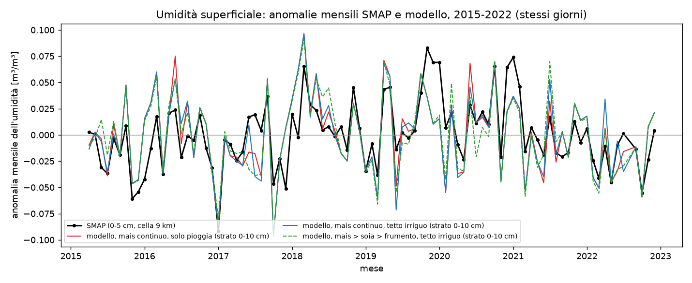
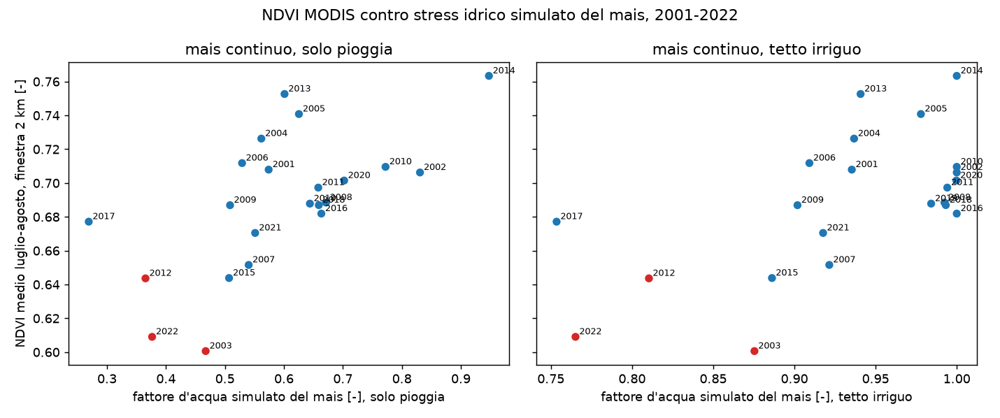
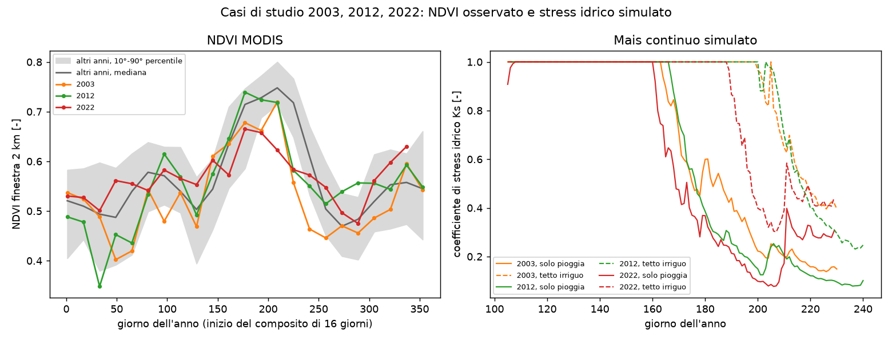
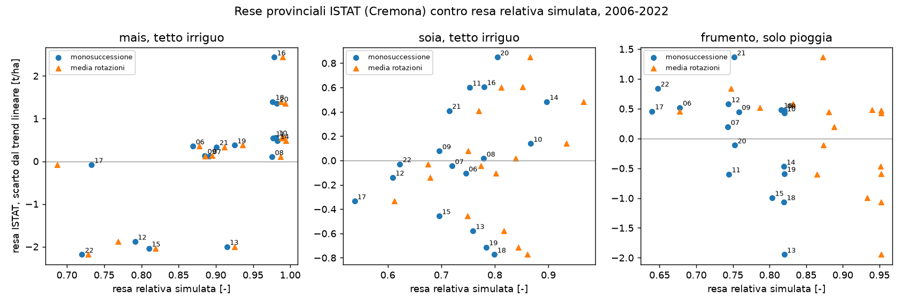

# Validazione del motore (fase 6)

Punto pilota lat 45,2, lon 10,0 (provincia di Cremona). Codice: `src/fieldwise/validation.py`
(`python -m fieldwise.validation`, offline). Risultati salvati: `data/processed/lat45.200_lon10.000/`
`validation_summary.json`, `validation_smap_mensile.csv`, `validation_ndvi_annuale.csv`, `validation_istat.csv`.

## Regole seguite

- Le scelte di metodo sono state fissate prima di guardare i risultati. Nessun parametro del motore è stato
  toccato e nessun confronto è stato scelto o scartato in base al risultato. Tutti i confronti calcolati sono
  riportati qui sotto, anche quelli negativi.
- **Intervalli di confidenza al 95%.**
  - Serie mensili (A): bootstrap a blocchi mobili di 6 mesi consecutivi, 5000 repliche, percentili 2,5–97,5.
    L'anomalia SMAP ha autocorrelazione a un mese pari a 0,36, quindi la trasformata di Fisher con n = 92 mesi
    darebbe intervalli troppo stretti. Il bootstrap salta i mesi esclusi: è un'approssimazione.
  - Serie annuali (B, C, D): trasformata di Fisher per Pearson e varianza di Bonett-Wright per Spearman.
    Gli scarti interannuali sono quasi indipendenti (autocorrelazione a un anno tra −0,27 e +0,11).
- **Pioggia delle simulazioni.** Si usa `rain_source="power"`, che fino al 2022 coincide con il default
  (pioggia ed ET0 identiche: lo verifica `run_all`). Il motivo: il ciclo valutato di un anno termina ad aprile
  dell'anno dopo, e con il default la coltura 2022 non sarebbe simulabile. Nessun valore delle colture fino al
  2022 dipende dalla pioggia caduta dopo la loro raccolta.
- **Scenario d'acqua rappresentativo, scelto a priori: `tetto_irriguo`.** Nella provincia il mais e la soia
  sono in prevalenza irrigati, e il tetto (200 mm netti per il mais) viene dai volumi effettivamente distribuiti
  nelle aziende lombarde (`params/scenarios.yaml`). La resa provinciale mescola campi irrigati e campi in
  asciutto. Lo scenario `solo_pioggia` ignora un'irrigazione diffusa; `irrigazione_libera` rappresenta il
  potenziale. Tutti e tre gli scenari sono riportati.

## A. Umidità superficiale SMAP

Il confronto mette SMAP SPL3SMP_E (0–5 cm, cella da 9 km, 2323 giorni di qualità raccomandata) contro
`theta_e` del modello (strato evaporante Ze = 10 cm, a fine giorno; nel metodo doppio è la frazione esposta).
Si usano gli stessi giorni per le due serie, solo i mesi con almeno 5 giorni validi, e le anomalie rispetto
alla climatologia mensile dello stesso periodo. Ogni configurazione è una sola simulazione continua, avviata
nel 2013 (mais) o nel 2012 (rotazione).

| Configurazione | Scenario | Periodo | Mesi | Pearson anomalie [IC 95%] | Spearman anomalie [IC 95%] | Pearson valori grezzi |
|---|---|---|---|---|---|---|
| mais continuo | solo pioggia | 2015-04 → 2022 | 92 | +0,73 [+0,64, +0,83] | +0,77 [+0,69, +0,85] | +0,87 [+0,82, +0,91] |
| mais continuo | tetto irriguo | 2015-04 → 2022 | 92 | +0,71 [+0,62, +0,81] | +0,74 [+0,65, +0,82] | +0,85 [+0,79, +0,89] |
| mais continuo | irrigazione libera | 2015-04 → 2022 | 92 | +0,72 [+0,63, +0,81] | +0,74 [+0,67, +0,82] | +0,85 [+0,80, +0,89] |
| mais > soia > frumento | solo pioggia | 2015-04 → 2022 | 92 | +0,73 [+0,65, +0,82] | +0,76 [+0,67, +0,84] | +0,87 [+0,81, +0,91] |
| mais > soia > frumento | tetto irriguo | 2015-04 → 2022 | 92 | +0,70 [+0,62, +0,79] | +0,71 [+0,60, +0,81] | +0,85 [+0,79, +0,89] |
| mais > soia > frumento | irrigazione libera | 2015-04 → 2022 | 92 | +0,68 [+0,58, +0,78] | +0,69 [+0,57, +0,80] | +0,85 [+0,79, +0,89] |
| *secondaria* mais continuo | tetto irriguo | 2015-04 → 2025-04 | 120 | +0,76 [+0,67, +0,83] | +0,78 [+0,68, +0,85] | +0,84 [+0,80, +0,88] |
| *secondaria* rotazione | tetto irriguo | 2015-04 → 2024-04 | 108 | +0,73 [+0,63, +0,80] | +0,72 [+0,60, +0,80] | +0,85 [+0,80, +0,89] |

L'analisi secondaria usa la pioggia POWER dopo il 2022, che non è affidabile (D1). Finisce dove finisce
l'ultimo ciclo simulabile: per questo il periodo è diverso tra mais e rotazione. I valori grezzi contengono il
ciclo stagionale, che entrambe le serie seguono per costruzione, quindi dicono poco: il confronto informativo
è quello sulle anomalie. Medie del periodo principale: SMAP 0,224, modello 0,19–0,20 m³/m³. Deviazione standard
delle anomalie: SMAP 0,032, modello 0,038 m³/m³. Autocorrelazione delle anomalie a un mese: SMAP 0,36,
modello circa 0,0–0,07.

**Interpretazione.**
- *Cosa conferma.* La dinamica dello strato superficiale è plausibile: risposta alle piogge e
  all'evaporazione, e un ordine di grandezza corretto delle anomalie (r ≈ 0,7, intervallo tutto sopra 0,58).
  Il risultato regge nel periodo secondario e nella rotazione.
- *Cosa non conferma.* Gli scenari d'acqua sono indistinguibili (0,68–0,73, intervalli sovrapposti).
  Nel motore `theta_e` è la frazione esposta dello strato evaporante e l'irrigazione la sposta poco: le medie
  differiscono di appena 0,007 m³/m³ tra gli scenari. In più la cella SMAP mescola campi irrigati e non
  irrigati. SMAP quindi **non** valida l'acqua della zona radicale,
  l'irrigazione o lo stress delle colture.
- *Limiti delle osservazioni.* SMAP misura 0–5 cm invece di 0–10 cm, su una cella da 9 km che contiene
  superfici diverse dai seminativi, al passaggio delle 6 del mattino invece che a fine giorno. Lo strato
  simulato è un po' più secco in media (circa −0,03 m³/m³). Su valori assoluti di questo tipo non si
  trae alcuna conclusione.
- *Limiti del modello.* Le anomalie simulate non persistono da un mese all'altro, quelle di SMAP sì (0,36).
  Lo strato di 10 cm si asciuga e si ribagna in pochi giorni e manca la risalita dalla falda (110–150 cm).
- *Avvertenza.* Le due serie condividono la pioggia come causa principale. Una parte dell'accordo misura
  quindi la qualità della pioggia POWER nel giorno giusto (D8: correlazione giornaliera con il pluviometro
  0,59), non solo il bilancio.

## B. NDVI MODIS contro stress idrico simulato del mais (2001–2022)

Il confronto mette l'NDVI della finestra 9×9 (circa 2 km, pixel buoni o marginali) contro `f_acqua` del mais
continuo (ciclo valutato con un anno di avviamento). Il 2000 è escluso perché non ha un anno di avviamento.
n = 22.

| Indicatore NDVI | Scenario | n | Pearson [IC 95%] | Spearman [IC 95%] |
|---|---|---|---|---|
| media luglio–agosto | solo pioggia | 22 | +0,63 [+0,29, +0,83] | +0,62 [+0,23, +0,84] |
| media luglio–agosto | tetto irriguo | 22 | +0,60 [+0,25, +0,82] | +0,60 [+0,20, +0,83] |
| picco giugno–agosto | solo pioggia | 22 | +0,55 [+0,17, +0,79] | +0,54 [+0,13, +0,80] |
| picco giugno–agosto | tetto irriguo | 22 | +0,53 [+0,15, +0,78] | +0,54 [+0,12, +0,80] |

**Casi di studio.** Rango 1 = valore più basso su 22 anni.

| Anno | NDVI lug–ago (rango) | f_acqua solo pioggia (rango) | f_acqua tetto irriguo (rango) |
|---|---|---|---|
| 2003 | 0,601 (1) | 0,47 (4) | 0,88 (4) |
| 2012 | 0,644 (3) | 0,37 (2) | 0,81 (3) |
| 2022 | 0,609 (2) | 0,38 (3) | 0,77 (2) |

Il 2017 è l'anno più stressato per il modello (0,27 e 0,75), ma per l'NDVI è un anno nella norma
(0,677, rango 7).

Nel 2022 l'NDVI della finestra si stacca dalla mediana dalla fine di luglio. Lo stress simulato parte a
metà giugno in solo pioggia e a inizio luglio con il tetto irriguo, quando il tetto è esaurito.

**Eterogeneità della finestra (avvertenza quantificata).**
- La deviazione standard tra pixel dell'NDVI di luglio–agosto vale in media 0,081. È il doppio della
  variabilità tra anni della media della finestra (0,041).
- In media il 5% dei pixel è sotto 0,5 (stoppie di frumento, suolo nudo).
- Nel 2022 il 59% dei pixel scende di oltre 0,05 rispetto alla propria mediana, mentre l'11% sale.
  Questi sono probabilmente campi irrigati o colture diverse.
- La finestra non distingue il mais dalle altre colture né i campi irrigati da quelli in asciutto.

**Interpretazione.**
- *Cosa conferma.* Il modello e l'NDVI riconoscono le stesse annate di siccità (2003, 2012, 2022 tra i quattro
  peggiori per entrambi) e la correlazione è positiva con intervallo tutto sopra lo zero.
- *Cosa non conferma.*
  - Non c'è una relazione quantitativa: l'NDVI della finestra varia di poco (0,60–0,76) mentre `f_acqua`
    varia di 3 volte.
  - Il confronto non dice quale scenario d'acqua sia giusto (0,60 contro 0,63).
  - Il modello esagera il 2017.
- *Limiti delle osservazioni.* L'NDVI satura sulle chiome chiuse. La finestra mescola colture, date di semina
  e irrigazione. Il composito di 16 giorni sfuma i picchi.
- *Limiti del modello.* Lo stress in solo pioggia è molto forte (f_acqua 0,27–0,95, Ks fino a 0,1 a luglio).
  Il motivo probabile è la falda superficiale, che il modello non rappresenta: in zona alimenta le radici
  per risalita capillare.

## C. Rese ISTAT provinciali (2006–2022)

Il confronto mette la resa provinciale detrendizzata (residuo da una retta nel tempo, t/ha) contro la resa
relativa simulata della stessa coltura nello stesso anno di raccolta.
- **Monosuccessione:** ogni anno valutato dopo un anno di avviamento.
- **Media delle rotazioni:** tutte le 216 rotazioni di tre colture, con e senza cover, e tutti gli anni di
  partenza il cui ciclo valutato contiene quella coltura in quell'anno.

In entrambi i casi c'è anche la variante sulle differenze prime. n = 17: gli intervalli sono larghi, e una
correlazione di 0,5 ha un intervallo che va da circa 0,05 a 0,8.

| Coltura | Scenario | Simulazione | Pearson detrend [IC 95%] | Spearman detrend [IC 95%] | Pearson differenze prime [IC 95%] |
|---|---|---|---|---|---|
| mais | solo pioggia | monosuccessione | +0,54 [+0,09, +0,81] | +0,74 [+0,34, +0,91] | +0,79 [+0,49, +0,92] |
| mais | solo pioggia | media rotazioni | +0,56 [+0,10, +0,82] | +0,76 [+0,39, +0,92] | +0,80 [+0,51, +0,93] |
| **mais** | **tetto irriguo** | monosuccessione | **+0,70 [+0,33, +0,88]** | +0,81 [+0,47, +0,94] | +0,83 [+0,58, +0,94] |
| mais | tetto irriguo | media rotazioni | +0,66 [+0,27, +0,87] | +0,80 [+0,46, +0,94] | +0,80 [+0,51, +0,93] |
| mais | irrigazione libera | monosuccessione | +0,53 [+0,07, +0,81] | +0,54 [+0,04, +0,82] | +0,78 [+0,47, +0,92] |
| mais | irrigazione libera | media rotazioni | +0,53 [+0,07, +0,81] | +0,54 [+0,04, +0,82] | +0,78 [+0,47, +0,92] |
| soia | solo pioggia | monosuccessione | +0,34 [−0,16, +0,71] | +0,35 [−0,17, +0,72] | +0,52 [+0,03, +0,81] |
| soia | solo pioggia | media rotazioni | +0,34 [−0,17, +0,71] | +0,35 [−0,17, +0,72] | +0,52 [+0,03, +0,81] |
| **soia** | **tetto irriguo** | monosuccessione | **+0,27 [−0,24, +0,67]** | +0,29 [−0,23, +0,68] | +0,41 [−0,11, +0,75] |
| soia | tetto irriguo | media rotazioni | +0,28 [−0,23, +0,67] | +0,32 [−0,20, +0,70] | +0,44 [−0,07, +0,77] |
| soia | irrigazione libera | monosuccessione | +0,15 [−0,36, +0,59] | +0,22 [−0,30, +0,64] | +0,33 [−0,20, +0,71] |
| soia | irrigazione libera | media rotazioni | +0,15 [−0,36, +0,59] | −0,06 [−0,53, +0,43] | +0,33 [−0,20, +0,71] |
| **frumento** | solo pioggia (non irrigato) | monosuccessione | **−0,50 [−0,79, −0,03]** | −0,52 [−0,81, −0,02] | −0,24 [−0,66, +0,29] |
| frumento | solo pioggia (non irrigato) | media rotazioni | −0,49 [−0,78, −0,01] | −0,55 [−0,83, −0,06] | −0,31 [−0,70, +0,21] |

**Interpretazione.**

- **Mais: confermato, con cautela.** Nello scenario rappresentativo r = 0,70 [0,33, 0,88]. Il risultato
  regge con le differenze prime e con la media delle rotazioni, e senza il 2022 r vale ancora 0,63. Questa
  verifica senza il 2022 è diagnostica ed è stata aggiunta dopo: non sostituisce il risultato.
  - Gli anni sbagliati sono il 2013 e il 2017. Nel 2013 la resa è −2,0 t/ha mentre il modello in tetto
    irriguo dà 0,91: la primavera molto piovosa ha ritardato le semine, e il modello non lo rappresenta. Nel
    2017 il modello prevede una forte perdita (0,73) che la resa reale non mostra (−0,1 t/ha).
  - In `irrigazione_libera` f_acqua vale 1 tutti gli anni, quindi la correlazione residua (0,53) viene solo
    dal caldo in fioritura (f_caldo 0,93 nel 2015, 0,96 nel 2019 e nel 2022). Il fattore caldo porta quindi
    un segnale, ma è debole.
  - Che `tetto_irriguo` correli meglio è coerente con la scelta a priori, ma non è la ragione della scelta.
- **Soia: non confermata.** Tutti gli intervalli dei residui dal trend comprendono lo zero (r 0,15–0,34). Solo
  le differenze prime in solo pioggia sono appena sopra lo zero. Le rese provinciali della soia variano poco
  (±0,8 t/ha) e includono la soia di secondo raccolto, che il modello non simula.
- **Frumento: negativa.** La correlazione è opposta al previsto, con intervallo tutto sotto lo zero (il limite
  superiore è vicino a zero). Con le differenze prime l'intervallo comprende lo zero.
  - Il modello penalizza solo la siccità primaverile: per lui gli anni peggiori sono 2006, 2017 e 2022.
    In pianura padana le perdite reali vengono invece dagli anni umidi (2013 −1,9 t/ha; 2015, 2018 e 2019
    tra −0,6 e −1,1), con malattie fungine, allettamento e ristagno. Gli anni secchi sono buoni
    (2017 +0,5, 2022 +0,8).
  - In più la falda a 110–150 cm alimenta in primavera le radici del frumento, che arrivano a quella
    profondità: lo stress simulato negli anni secchi è probabilmente spurio.
  - *Limite del modello:* la resa relativa del frumento non va letta come indicatore di rischio annuale in
    questa zona.
- **Limiti delle osservazioni.**
  - Rese provinciali stimate e arrotondate.
  - Irriguo e asciutto mescolati, umidità di riferimento ignota.
  - n = 17.
  - Il trend lineare è una scelta: le differenze prime lo evitano, e le conclusioni non cambiano per il mais.

## D. Robustezza (mais, monosuccessione, residui dal trend)

| Variante | solo pioggia | tetto irriguo | irrigazione libera |
|---|---|---|---|
| Kc doppio, POWER (riferimento) | +0,54 [+0,09, +0,81] | +0,70 [+0,33, +0,88] | +0,53 [+0,07, +0,81] |
| Kc singolo, POWER | +0,54 [+0,08, +0,81] | +0,70 [+0,33, +0,88] | +0,53 [+0,07, +0,81] |
| Kc doppio, IMERG | +0,63 [+0,21, +0,85] | +0,73 [+0,38, +0,89] | +0,53 [+0,07, +0,81] |

Le conclusioni non cambiano né con il metodo dell'evapotraspirazione né con la fonte della pioggia.

## Sintesi

- **SMAP:** la dinamica dell'umidità superficiale è riprodotta (anomalie mensili r ≈ 0,7, IC circa 0,6–0,8), ma
  il confronto non distingue gli scenari irrigui e non dice nulla sulla zona radicale.
- **NDVI:** gli anni di siccità coincidono (2003, 2012, 2022; r ≈ 0,6, IC 0,2–0,8). La relazione è solo
  ordinale, la finestra mescola colture, e il modello esagera il 2017.
- **ISTAT:** il mais è confermato (r 0,70 [0,33, 0,88] nello scenario rappresentativo), la soia non è
  confermata (intervalli che comprendono lo zero), il frumento è negativo (−0,50 [−0,79, −0,03]).
  Le rese reali del frumento calano negli anni umidi, che il modello non penalizza.

## Cosa NON è stato validato

- Bilancio dell'azoto: concime, assorbimento, mineralizzazione, fissazione della soia. Non ci sono osservazioni.
- Humus e sostanza organica: nessuna serie storica di campo.
- Lisciviazione dei nitrati e percolazione: nessuna misura di drenaggio o di concentrazione.
- Ruscellamento e volumi irrigui: nessun dato per anno.
- Effetto delle cover crop e penalità di rotazione: la resa provinciale non le separa.
- Gli anni dopo il 2022, se non nell'analisi secondaria SMAP (pioggia POWER non affidabile).
